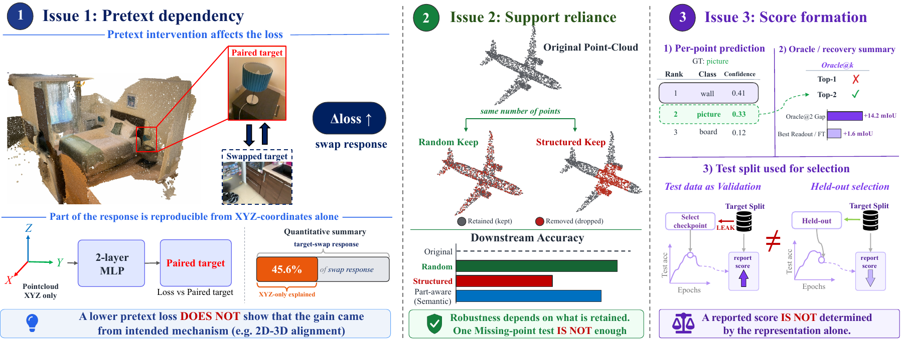

<div align="center">

# What Downstream Scores Miss in Point-Cloud Self-Supervised Learning

[](https://kohsukeide.github.io/projects/beyond-downstream-scores/)
[](LICENSE)

Kohsuke Ide<sup>1,2</sup> · Ryousuke Yamada<sup>1,3</sup> · Yue Qiu<sup>1</sup> · Yoshihiro Fukuhara<sup>1,4</sup><br>
Hirokatsu Kataoka<sup>1,5</sup> · Yuki M. Asano<sup>3</sup> · Yutaka Satoh<sup>1,2</sup>

<sup>1</sup>AIST &nbsp; <sup>2</sup>University of Tsukuba &nbsp; <sup>3</sup>Fundamental AI Lab, University of Technology Nuremberg<br>
<sup>4</sup>CADDi &nbsp; <sup>5</sup>Visual Geometry Group, University of Oxford

**NeurIPS 2026 Evaluations & Datasets Track · Spotlight**



</div>

## Overview

Downstream scores show benchmark performance but do not identify why a
point-cloud self-supervised representation improves. We use controlled
diagnostics to examine three parts of the evaluation pipeline: the pretext
objective, the visible geometric support, and the downstream readout and
reporting protocol.

This repository contains code for the paper. It does not introduce a new
dataset or redistribute raw datasets.

The repository provides:

1. CPU smoke tests for diagnostic operators.
2. Tables and plots generated from paper-reported summary CSV files.
3. Diagnostic reproduction entry points, sanitized patch excerpts, configs, and
   provenance summaries for the empirical analyses when official datasets,
   checkpoints, and external model implementations are available.

## Reproducibility Levels

### Level 0: Tables and Plots from CSVs

This level does not require raw datasets, checkpoints, or GPUs. It produces
tables and summary plots from the recorded values; plot styling may differ from
the figures in the paper.

```bash
git clone https://github.com/KohsukeIde/beyond-downstream-scores.git
cd beyond-downstream-scores
conda env create -f environment.yml
conda activate bds
bash scripts/make_tables.sh
bash scripts/make_figures.sh
```

Generated markdown tables are written to `results/generated_tables/`.
Generated figures are written to `results/generated_figures/`.

### Level 1: Unit Tests and Synthetic Smoke Tests

This level runs diagnostic operators on synthetic arrays.

```bash
pip install -e .
pytest -q
bash scripts/smoke_test.sh
```

These synthetic tests validate the diagnostic operators. They do not reproduce
the empirical paper results by themselves.

### Level 2: Full-diagnostic entry points and configuration wrappers

This level provides aggregation scripts, configuration wrappers, and sanitized
patch excerpts. Reproducing full experiments requires official datasets,
checkpoints, suitable GPU hardware, and the corresponding external model codebases.
Set the required local paths first:

```bash
export SCANNET_ROOT=/path/to/scannet
export SCANOBJECTNN_ROOT=/path/to/scanobjectnn
export SHAPENETPART_ROOT=/path/to/shapenetpart
export ARKITSCENES_ROOT=/path/to/arkitscenes
export SCANNETPP_ROOT=/path/to/scannetpp
export S3DIS_ROOT=/path/to/s3dis
export HM3D_ROOT=/path/to/hm3d
export STRUCTURED3D_ROOT=/path/to/structured3d
export CHECKPOINT_ROOT=/path/to/checkpoints
export OUTPUT_ROOT=/path/to/outputs
```

Then run the relevant diagnostic wrappers:

```bash
bash scripts/run_concerto_target_swap.sh
bash scripts/run_concerto_coordinate_closure.sh
bash scripts/run_concerto_representation_companion.sh
bash scripts/run_pointgpt_mask_order_relaxations.sh
bash scripts/run_scene_support_tests.sh
bash scripts/run_object_support_tests.sh
bash scripts/run_reported_score_oracle.sh
bash scripts/run_class_pair_diagnostics.sh
bash scripts/run_checkpoint_reporting.sh
```

The Level 2 scripts validate environment variables and print explicit messages
when a full external training or evaluation implementation is required. They do
not pretend to run heavy experiments when datasets or checkpoints are absent.
These scripts do not bundle the full external model implementations. They
check whether required dataset/checkpoint environment variables are set and
document the diagnostic entry points. Full execution requires official datasets,
checkpoints, and the corresponding external model codebases. The patch files in `reproduce/` are
sanitized excerpts that identify the relevant code changes; they are not
complete vendored replacements for the external repositories. Use the configs
listed in `docs/REPRODUCIBILITY.md`.

## Repository Map

- `src/bds/`: small, CPU-compatible diagnostic operators.
- `tests/`: synthetic unit tests for the operators.
- `configs/`: documented diagnostic configuration stubs.
- `scripts/`: Level 0/1 reproduction scripts and Level 2 wrappers.
- `reproduce/`: diagnostic entry points, sanitized patch excerpts, configs, and
  aggregation scripts for the empirical analyses.
- `results/ledgers/`: sanitized row-level provenance summaries used by the
  Level 2 aggregators.
- `results/paper_reported_results/`: compact CSVs used only for table and
  figure reproduction.
- `docs/`: dataset, checkpoint, compute, reproducibility, and third-party notes.

## Notes for Review

The CSV files under `results/paper_reported_results/` are paper-reported
summaries for Level 0 reproduction. They are not raw model outputs and should
not be interpreted as redistributed datasets or checkpoints. Full reproduction
requires the official datasets and checkpoints listed in `docs/DATA.md` and
`docs/CHECKPOINTS.md`. The paper-reported CSVs are compact summaries; the files
under `results/ledgers/` are sanitized provenance summaries derived from the
paper-reported experimental records. They are not raw model outputs, raw cluster
logs, or checkpoint artifacts.
